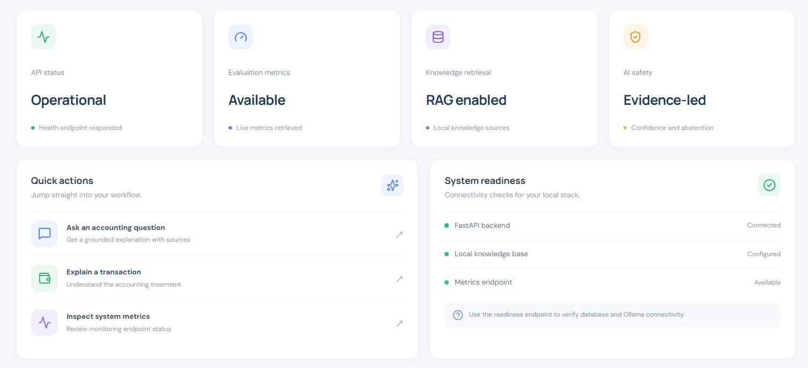
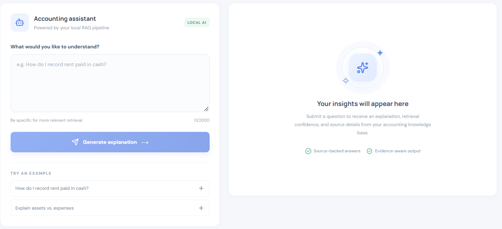
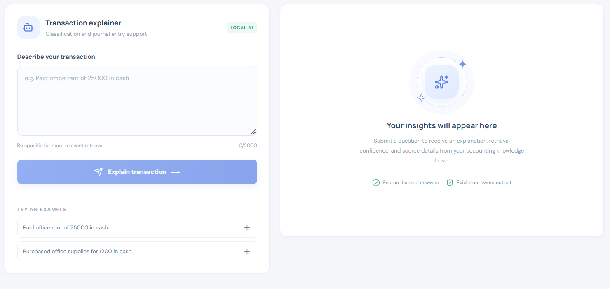
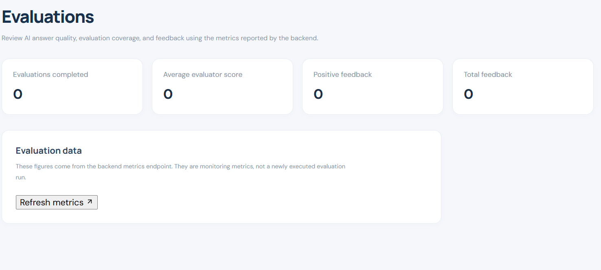

# AI Accounting Copilot

An end-to-end AI accounting assistant built with **Python, FastAPI, Retrieval-Augmented Generation (RAG), local LLM inference, deterministic accounting logic, automated evaluation, observability, auditability, data governance, and production-oriented reliability controls.**

The project demonstrates how to engineer an AI application beyond a basic LLM wrapper — from API design and retrieval through evaluation, reliability, governance, monitoring, and deployment preparation.

---

# Overview

AI Accounting Copilot helps users answer accounting questions and explain financial transactions using a domain-specific accounting knowledge base.

The system combines:

- FastAPI REST APIs
- Local LLM inference through Ollama
- Retrieval-Augmented Generation (RAG)
- Local text embeddings
- Evidence-based response generation
- Retrieval confidence signals
- Deterministic accounting logic
- Structured journal-entry generation
- Automated AI evaluation
- Configurable quality gates
- Human feedback collection
- Request-level observability
- RAG performance metrics
- Business outcome metrics
- AI audit logging
- Sensitive-data redaction
- Configurable audit retention
- Health and readiness checks
- Environment-based configuration
- Production-style startup configuration
- Docker deployment artifacts

The architecture follows a simple principle:

> AI systems should be grounded, evaluated, observable, reliable, governable, and operationally ready — not just capable of generating text.

---

# Key Capabilities

## 1. Grounded Accounting RAG

The application uses Retrieval-Augmented Generation to answer accounting questions using a domain-specific knowledge base.

The RAG pipeline:

1. Receives an accounting question.
2. Validates the request.
3. Generates an embedding for the query.
4. Retrieves relevant accounting knowledge.
5. Measures retrieval similarity.
6. Applies an evidence-sufficiency gate.
7. Abstains when sufficient evidence is unavailable.
8. Builds a grounded prompt from retrieved evidence.
9. Generates a response using the local LLM.
10. Returns the answer together with source information.

This reduces unsupported accounting responses by requiring sufficient retrieved evidence before generating an answer.

## 2. Accounting Intelligence

The accounting intelligence layer combines **generative AI with deterministic application logic**. These responsibilities are kept separate.

### Deterministic transaction classification

The implemented `classify_transaction()` function applies explicit rules to supported transaction patterns.

Currently supported example:

- Transaction description contains both `rent` and `cash`.
- Transaction amount must be greater than zero.
- Debit: Rent Expense.
- Credit: Cash.

Unsupported transaction patterns do not receive an automatically generated journal entry from this classifier.

### RAG and LLM functionality

The RAG pipeline retrieves relevant accounting knowledge and uses a local LLM to generate evidence-grounded explanations.

It also:

- Returns retrieved sources.
- Calculates a retrieval confidence signal.
- Abstains when sufficient evidence is unavailable.

Retrieval confidence is based on source similarity. It is not a calibrated probability or a measure of accounting classification correctness.

### Human-review safeguards

The transaction explanation response includes:

- `review_required`: indicates whether human review is required.
- `review_reason`: explains why review is required.

Current behavior:

| Scenario | Review required |
|---|---|
| Supported Rent + Cash rule with valid amount | No |
| Unsupported transaction pattern | Yes |
| Missing or invalid amount | Yes |

These flags identify transactions requiring human attention. They do not represent a completed approval workflow or guarantee that a supported classification is correct.

Uncertain or unsupported accounting entries should be reviewed by a qualified human before final posting.

Deterministic accounting logic is intentionally used where predictable behavior is more appropriate than relying entirely on an LLM.

---

# Architecture

```text
                    User / React Dashboard
                              |
                              v
                       FastAPI Application
                              |
             +----------------+----------------+
             |                |                |
             v                v                v
      Accounting          Request          Health /
      Intelligence        Logging          Readiness
             |            & Metrics
       +-----+------+
       |            |
       v            v
   RAG Service   Deterministic
       |         Transaction
       |         Classifier
       |
   +---+---+
   |       |
   v       v
Retriever Ollama LLM
   |      (qwen3:8b)
   |
   v
Knowledge Base
   |
   v
Local Embeddings
   |
   v
SQLite / Retrieval Storage

       Accounting Result
              |
       +------+------+
       |      |      |
       v      v      v
    Response Sources Review
                    Flags
```

Cross-cutting capabilities include evaluation, feedback collection, audit logging, data governance, and observability.

---

# Core AI Workflow

```text
User Request
     |
     v
API Validation
     |
     v
Request ID
     |
     v
RAG Retrieval
     |
     v
Evidence Sufficiency Check
     |
     +---- Insufficient Evidence ----> Safe Abstention
     |
     v
Grounded Prompt
     |
     v
Local LLM
     |
     v
Accounting Response
     |
     +----> Sources
     |
     +----> Retrieval Confidence
     |
     +----> Evaluation
     |
     +----> Audit Record
     |
     +----> Metrics
     |
     v
Client
```

---

# Example

### User Question

```text
How do I record rent paid in cash?
```

### Expected Accounting Treatment

```text
Debit: Rent Expense
Credit: Cash
```

The application returns the generated accounting response together with retrieved evidence and a retrieval confidence signal.

For supported transaction patterns, the accounting intelligence layer can additionally return structured journal-entry information.

---

# Safety-Oriented Abstention

A core design principle is that the system should not confidently answer questions when the available accounting evidence is insufficient.

If the retrieval layer cannot provide adequate supporting evidence, the system can return:

```text
The provided accounting knowledge does not contain enough information to answer this question.
```

This creates an explicit abstention path instead of treating every question as answerable.

The abstention behavior is also included in the automated evaluation system.

---

# AI Evaluation

The project contains a repeatable evaluation pipeline using a representative accounting test dataset.

The evaluation dataset covers:

- Accounting concepts
- Financial transactions
- Expected keywords
- Expected sources
- Supported questions
- Unsupported questions
- Safe-abstention scenarios

## Evaluation dimensions

The evaluation pipeline measures:

- Pass rate
- Keyword coverage
- Source correctness
- Grounding
- Completeness
- Evaluator score
- Quality-gate status

The deterministic response evaluator checks:

- Response presence
- Source availability
- Accounting terminology
- Grounding in retrieved sources
- Question relevance
- Safe-abstention behavior
- Unsupported-claim prevention

The evaluator produces a heuristic quality score. It is an operational signal and does not independently establish factual or accounting correctness.

## Model comparison

The project supports comparing multiple local LLMs against the same evaluation dataset.

Run a comparison using:

```powershell
python -m evals.run_comparison
```

For a smaller smoke test:

```powershell
python -m evals.run_comparison --limit 1 --models llama3.2:latest
```

The comparison pipeline:

1. Loads the accounting evaluation dataset.
2. Retrieves shared evidence for evaluation cases.
3. Uses the same retrieved evidence across the models being compared.
4. Generates responses using the selected Ollama models.
5. Evaluates each response.
6. Captures generation metadata.
7. Calculates aggregate model metrics.
8. Applies configurable release-eligibility thresholds.
9. Generates a JSON comparison report.

## Model comparison metrics

The comparison report records:

- Pass rate
- Average evaluator score
- Keyword score
- Source score
- Grounding score
- Completeness score
- Average generation latency
- Latency sample count
- Prompt token count
- Completion token count
- Total token count
- Monetary cost, when configured
- Release eligibility

## Evaluation traceability

Each comparison report includes:

- Evaluation dataset fingerprint
- Shared evidence manifest
- Evidence fingerprints
- Retrieved source names
- Retrieved chunk identifiers
- Retrieval similarity scores
- Model generation metadata
- Evaluation results
- Release thresholds
- Release recommendation

This makes it possible to trace which dataset and retrieved evidence were used during an evaluation.

## Release eligibility

The current comparison pipeline uses configured thresholds:

```text
Minimum pass rate: 0.80
Minimum evaluator score: 0.75
All evaluation cases must pass
All evaluator checks must pass
```

A model that satisfies these checks can be marked as a release candidate.

This is an evaluation-based eligibility signal, not an automatic production deployment approval.

## Latest comparison smoke test

```text
Model: llama3.2:latest
Evaluation cases: 1
Passed cases: 1
Pass rate: 100%
Evaluator score: 1.00
Average latency: 37.39 seconds
Total tokens: 1,127
Release eligible: True
```

The report was generated successfully.

This result validates the comparison workflow for one test case. It should not be interpreted as full-dataset validation or proof of production readiness.

## Cost measurement

The comparison pipeline captures token usage and supports monetary cost reporting.

For local Ollama inference, monetary cost is currently reported as unavailable because local inference pricing is not configured.

## Evaluation limitations

The evaluator is deterministic and heuristic-based. It checks configured response properties but does not guarantee accounting correctness.

The release recommendation depends on the evaluation dataset, evidence, thresholds, and sample size. Larger evaluation runs are necessary before making meaningful model-release decisions.

The evaluation system provides a repeatable mechanism for detecting regressions when retrieval, prompts, accounting logic, or model behavior change.

---

# Observability

The application includes request-level and AI-specific observability.

Tracked signals include:

- Request count
- Request duration
- Slow requests
- RAG retrieval latency
- LLM generation latency
- RAG request count
- RAG abstention count
- Evaluator scores
- User feedback
- Accounting questions answered
- Accounting questions safely abstained
- Transaction explanations

Each request is assigned a request ID for correlation across application operations.

Example request metadata:

```text
request_id
HTTP method
path
status code
duration
```

User prompt bodies are deliberately not logged by request middleware.

---

# Business Metrics

The system tracks application-level business outcomes in addition to technical metrics.

Current business signals include:

```text
Accounting Questions Answered
Accounting Questions Abstained
Transaction Explanations
Total Accounting Questions
Overall Answer Rate
```

This separates:

```text
System Performance
        +
AI Quality
        +
User Feedback
        +
Business Outcomes
```

into measurable operational signals.

---

# AI Auditability

Accounting intelligence requests can be recorded in an AI audit log.

Audit records contain:

- Request ID
- User question
- AI response
- Retrieved sources
- Evaluator score
- Timestamp

Audit records are stored in SQLite and can be retrieved through a protected audit API.

The audit layer provides traceability for understanding what the system received, what it generated, what evidence was used, and how the response was evaluated.

Supported AI requests can be recorded; this does not imply that every request is necessarily persisted.

---

# Data Governance

The project includes basic data-governance controls for AI audit records.

Implemented controls include:

- API-key protection for audit-log access
- Email redaction before audit storage
- Indian phone-number redaction before audit storage
- Configurable audit retention
- Controlled access to operational AI records
- Environment-based secrets and configuration

Example:

```text
john@example.com
```

is stored as:

```text
[REDACTED_EMAIL]
```

Sensitive configuration is kept in `.env` rather than source code.

---

# Security Controls

The application includes:

- Pydantic request validation
- Maximum prompt-length enforcement
- Safe error responses
- Request correlation IDs
- RAG evidence gating
- Safe abstention
- Environment-based configuration
- Protected audit API
- Configurable metrics exposure
- Sensitive-data redaction
- Separation of `.env` and `.env.example`

The audit API key protects audit-log access; it does not mean every application endpoint is authenticated.

The project does not claim to be a complete enterprise security platform. These controls represent the security and governance foundation implemented in the current application.

---

# Reliability and Readiness

The application provides two operational endpoints.

## Health

```text
GET /health
```

Used as a lightweight liveness check.

Example:

```json
{
  "status": "healthy",
  "service": "AI Accounting Copilot",
  "version": "0.1.0",
  "environment": "development"
}
```

## Readiness

```text
GET /ready
```

The readiness endpoint checks:

- Database availability
- Ollama availability

Example successful response:

```json
{
  "status": "ready",
  "service": "AI Accounting Copilot",
  "version": "0.1.0",
  "environment": "production",
  "database": "available",
  "ollama": "available"
}
```

If a required dependency is unavailable, the endpoint returns a non-ready response rather than incorrectly reporting that the service is operational.

---

# Main API Endpoints

| Endpoint | Purpose |
|---|---|
| `POST /accounting/rag` | Grounded accounting question answering |
| `POST /accounting/intelligence` | Accounting concept explanation |
| `POST /accounting/transaction/explain` | Transaction explanation and structured accounting intelligence |
| `POST /feedback` | Record user feedback |
| `GET /metrics` | Application and RAG metrics |
| `GET /metrics/feedback` | Feedback metrics |
| `GET /metrics/quality` | AI quality and business metrics |
| `GET /metrics/summary` | Consolidated operational, quality, feedback, and business metrics |
| `GET /audit/logs` | Protected AI audit-log access |
| `POST /llm/generate` | Local LLM generation |
| `GET /health` | Liveness check |
| `GET /ready` | Dependency readiness check |

Audit-log access requires the configured audit API key.

---

# Technology Stack

| Area | Technology |
|---|---|
| Language | Python |
| API | FastAPI |
| LLM | Ollama / qwen3:8b |
| Embeddings | nomic-embed-text |
| RAG | Custom retrieval pipeline |
| Database | SQLite |
| ORM | SQLAlchemy |
| Validation | Pydantic |
| Testing | pytest |
| Server | Uvicorn |
| Configuration | python-dotenv / environment variables |
| Frontend | React, TypeScript, Vite |
| Deployment | Docker artifacts and production startup script |

The system is **local-first** and does not require a paid hosted LLM API.

---

# Local-First AI Architecture

The application uses Ollama for local LLM inference.

This provides:

- No paid API dependency
- Local model execution
- Local development
- Reproducible AI experimentation
- Greater control over application data flow

Current language model:

```text
qwen3:8b
```

Embedding model:

```text
nomic-embed-text
```

An alternative local model used for comparison is:

```text
llama3.2:latest
```

This architecture makes the project suitable for development and demonstration without requiring a commercial model API key.

---

# Project Structure

```text
ai-accounting-copilot/
|
+-- app/
|   +-- api/
|   |   +-- routes/
|   +-- core/
|   +-- db/
|   +-- models/
|   +-- prompts/
|   +-- rag/
|   +-- repositories/
|   +-- schemas/
|   +-- services/
|
+-- frontend/
|   +-- src/
|   +-- package.json
|
+-- api/
+-- rag/
+-- services/
+-- agents/
+-- tools/
+-- data/
+-- knowledge_base/
|
+-- evals/
|   +-- results/
|   +-- run_comparison.py
|
+-- tests/
+-- docs/
|   +-- ACCOUNTING_WORKFLOW.md
|   +-- architecture.md
|   +-- evaluation.md
|
+-- Dockerfile
+-- .dockerignore
+-- .env.example
+-- .gitignore
+-- requirements.txt
+-- start_production.ps1
+-- test_retrieval.py
+-- README.md
```

---

# Running Locally

## 1. Clone the repository

```powershell
git clone <your-repository-url>
cd ai-accounting-copilot
```

## 2. Create and activate a virtual environment

```powershell
python -m venv .venv
.\.venv\Scripts\Activate.ps1
```

## 3. Install backend dependencies

```powershell
pip install -r requirements.txt
```

## 4. Configure environment variables

Copy the example configuration:

```powershell
Copy-Item .env.example .env
```

Generate a secure audit API key:

```powershell
python -c "import secrets; print(secrets.token_urlsafe(32))"
```

Place the generated key in your local `.env` file:

```text
AUDIT_API_KEY=your-generated-secret
```

Never commit the actual `.env` file or expose its contents.

## 5. Install and verify Ollama models

Make sure [Ollama](https://ollama.com/) is installed and running.

Pull the required models:

```powershell
ollama pull qwen3:8b
ollama pull nomic-embed-text
```

Verify that both models are available:

```powershell
ollama list
```

Required models:

- `qwen3:8b` — local language model for accounting responses.
- `nomic-embed-text` — embedding model for knowledge retrieval.

The optional alternative language model used for model comparison is:

```powershell
ollama pull llama3.2:latest
```

## 6. Start the FastAPI application

From the project root:

```powershell
python -m uvicorn app.main:app --host 127.0.0.1 --port 8000
```

The API will be available at:

```text
http://127.0.0.1:8000
```

Interactive API documentation:

```text
http://127.0.0.1:8000/docs
```

---

# Frontend Dashboard

The project includes a React and TypeScript dashboard built with Vite, providing a user interface for accounting assistance, transaction workflows, knowledge-base access, AI evaluation metrics, monitoring, audit and safety information, and application settings.

## Frontend Technology Stack

- React
- TypeScript
- Vite
- REST API integration
- CSS

## Run the Frontend Locally

Open a second PowerShell terminal while the FastAPI backend is running.

### 1. Navigate to the frontend directory

```powershell
cd frontend
```

### 2. Install dependencies

```powershell
npm install
```

### 3. Configure the API URL

Create a `.env` file inside the `frontend` directory with:

```text
VITE_API_BASE_URL=http://127.0.0.1:8000
```

This configures the frontend to communicate with the local FastAPI backend.

### 4. Start the development server

```powershell
npm run dev
```

Open the local URL printed by Vite in the terminal.

Keep the backend and frontend running in separate terminals.

## Production Build

To verify that the frontend compiles for production:

```powershell
npm run build
```

The generated production assets are written to `frontend/dist/`. This generated directory should not be committed to version control.

---

# Production-Style Local Startup

The repository includes:

```text
start_production.ps1
```

Run:

```powershell
.\start_production.ps1
```

The production-style startup configuration uses:

```text
ENVIRONMENT=production
```

and starts Uvicorn on:

```text
0.0.0.0:8000
```

Binding to `0.0.0.0` exposes the server on available network interfaces. Use appropriate network restrictions when network access is not intended.

Docker is not required for the current local development environment. Docker artifacts are included to provide deployment portability.

**Security note:** This script provides a production-style local startup configuration, not a complete production deployment. An actual deployment also requires appropriate network restrictions, authentication, HTTPS, and secret management.

---

# Environment Configuration

Configuration is environment-based.

Example `.env` values:

```text
APP_NAME=AI Accounting Copilot
APP_VERSION=0.1.0
ENVIRONMENT=production
DATABASE_URL=sqlite:///./accounting.db
OLLAMA_BASE_URL=http://localhost:11434
OLLAMA_MODEL=qwen3:8b
RAG_SIMILARITY_THRESHOLD=0.45
EXPOSE_METRICS=false
MAX_PROMPT_LENGTH=5000
AUDIT_API_KEY=your-generated-secret
AUDIT_RETENTION_DAYS=90
```

Secrets and environment-specific configuration should not be committed to source control.

The repository provides `.env.example` as a configuration template. Use a placeholder for `AUDIT_API_KEY` in that file, never a real credential.

## Security and Operational Configuration

- `AUDIT_API_KEY` protects audit API access through the `X-Audit-API-Key` request header. If the key is not configured, audit access is disabled.
- `AUDIT_RETENTION_DAYS` controls the audit retention period. The default is 90 days.
- `EXPOSE_METRICS` controls whether metrics endpoints are accessible. The application configuration defaults this setting to `true` when the variable is absent; the example configuration explicitly sets it to `false`.

Keep API keys and other secrets in the local `.env` file. Never commit real credentials to version control.

---

# Evaluation and Operational Metrics

The project exposes multiple layers of system signals.

## Technical signals

```text
Request count
Request latency
Slow requests
RAG retrieval latency
LLM generation latency
RAG abstentions
```

## AI quality signals

```text
Evaluator score
Evaluation count
Source correctness
Grounding
Completeness
```

## Human feedback signals

```text
Positive feedback
Negative feedback
Positive feedback rate
```

## Business signals

```text
Accounting questions answered
Accounting questions abstained
Transaction explanations
Overall answer rate
```

This provides a foundation for evaluating the application across more than model output alone.

---

# Testing

Run the complete test suite:

```powershell
python -m pytest -q
```

The test suite covers:

- Accounting intelligence
- Transaction explanations
- Database behavior
- API routes
- Invoice operations
- Transaction operations
- Journal entries
- LLM integration
- RAG chunking
- RAG embeddings
- RAG loading
- RAG retrieval
- RAG service behavior
- Evaluation
- Feedback
- Metrics
- Audit logging
- Audit API security
- Data governance
- Audit retention
- Health and readiness

## Latest full regression

```text
118 passed, 0 failed
```

The current suite contains **118 automated tests**.

The automated test suite validates application behavior using controlled test cases. Runtime health and readiness checks are documented separately under Production Validation.

---

# Production Validation

The application has been smoke-tested using its production-oriented local startup configuration.

The following checks were verified:

## API Health

```text
GET /health
200 OK
```

## Application Readiness

```text
GET /ready

status: ready
database: available
ollama: available
```

## RAG Workflow

The accounting RAG endpoint was tested using:

```text
POST /accounting/rag
```

Test query:

```text
How do I record rent paid in cash?
```

The application successfully returned a grounded accounting response through the production-oriented startup configuration.

These checks demonstrate local application functionality and service readiness. They do not represent a complete production deployment or external infrastructure validation.

---

# Engineering Decisions

## Local-First AI

Ollama is used instead of a paid hosted model API.

This allows the complete AI workflow to run locally without requiring a paid API key.

## Grounded Generation

RAG retrieval and an evidence gate are used to reduce unsupported accounting responses.

## Deterministic Accounting Logic

Structured accounting behavior is implemented with deterministic application logic where appropriate.

This improves predictability for supported transaction patterns.

## Evaluation Before Optimization

The project includes a repeatable evaluation dataset and quality gate so changes to retrieval and model behavior can be measured systematically.

## Observability

Request-level and RAG-level metrics make latency, slow requests, and abstentions measurable.

## Human Feedback

User feedback is captured as an additional quality signal rather than relying exclusively on automated evaluation.

Feedback collection provides a quality signal; it does not currently implement a formal reviewer approval or rejection workflow.

## Auditability

Supported AI requests can be recorded with source references and evaluation metadata, providing traceability for recorded AI behavior.

## Data Governance

Sensitive information is redacted before audit storage, and audit access is protected.

## Environment-Based Configuration

Application configuration and secrets are separated from source code.

## Production-Oriented Design

The system includes health checks, readiness checks, structured logging, metrics, configuration management, deployment artifacts, automated testing, and operational controls.

---

# Enterprise AI Readiness

The project intentionally goes beyond a basic RAG demo and implements several capabilities relevant to production AI systems.

## Evaluation

- Representative evaluation dataset
- Automated evaluator
- Quality gates
- Source and grounding checks
- Safe-abstention evaluation
- Evaluator score tracking

## Human Feedback

- User feedback collection
- Positive/negative feedback tracking
- Feedback rate metrics

## Auditability

- AI audit records
- Request correlation
- Source tracking
- Evaluator-score tracking
- Protected audit API

## Data Governance

- Sensitive-data redaction
- Audit retention policy
- API-key-protected audit access
- Environment-based configuration

## Reliability

- Health checks
- Readiness checks
- Dependency validation
- Safe abstention
- Automated regression testing

## Observability

- Request metrics
- Latency metrics
- RAG metrics
- LLM metrics
- Slow-request tracking
- Abstention tracking

## Business Measurement

- Accounting questions answered
- Accounting questions abstained
- Transaction explanations
- Overall answer rate

These capabilities demonstrate the engineering considerations required when moving AI applications from experimentation toward production environments.

---

# Known Limitations

This is a portfolio-scale production-oriented system rather than a deployed enterprise accounting platform.

Current limitations include:

- SQLite is used for local persistence.
- Ollama provides local model inference rather than managed model serving.
- Retrieval confidence is based on similarity signals and is not a calibrated probability.
- The evaluator is deterministic and heuristic-based rather than a full LLM-as-a-judge system.
- Deterministic transaction classification currently covers a limited set of supported patterns.
- Human-review flags are implemented, but a complete reviewer assignment and approval workflow is not.
- The current deployment artifacts are production-oriented but have not been validated as a multi-node production deployment.
- The project does not claim real enterprise customer adoption or production traffic.

These limitations are documented so that future production evolution can be evaluated explicitly.

---

# Future Production Evolution

A larger production deployment could evolve toward:

```text
SQLite
   |
   v
PostgreSQL

Local Retrieval
   |
   v
Managed / Distributed Vector Infrastructure

Single Application
   |
   v
Scalable Service Architecture

Local Ollama
   |
   v
Managed Model Serving / Model Gateway

Basic Metrics
   |
   v
Centralized Observability Platform

Single-Tenant Application
   |
   v
Multi-Tenant Isolation

Local Audit Storage
   |
   v
Enterprise Audit / Compliance Infrastructure
```

Additional production evolution could include:

- Distributed tracing
- Centralized logging
- Advanced model evaluation
- LLM-as-a-judge evaluation
- Human approval workflows and reviewer assignment
- Multi-tenant authorization
- Role-based access control
- Rate limiting
- Secrets management
- Scalable vector infrastructure
- Model routing
- Cost attribution
- Continuous evaluation
- CI/CD deployment
- Production alerting
- Data lifecycle management

---

# Project Status

| Area | Status |
|---|---|
| Foundation | Implemented |
| Accounting Core | Implemented |
| Local LLM Integration | Implemented |
| RAG | Implemented |
| Accounting Intelligence | Implemented |
| AI Evaluation | Implemented |
| Human Feedback | Implemented |
| Reliability & Observability | Implemented |
| Auditability | Implemented |
| Data Governance | Implemented |
| Business Metrics | Implemented |
| Security Controls | Implemented |
| Production-Oriented Local Configuration | Implemented |
| Automated Testing | 118 tests passing |

## Current regression status

```text
118 passed
0 failed
```

These statuses describe the implemented portfolio scope, not a certification of enterprise production readiness.

---

# What This Project Demonstrates

This project demonstrates practical experience with:

- Python backend engineering
- FastAPI API development
- AI application architecture
- Local LLM integration
- Retrieval-Augmented Generation
- Embeddings
- Grounded generation
- Evidence-based abstention
- Deterministic AI-assisted workflows
- Structured accounting intelligence
- Automated evaluation
- Quality gates
- Human feedback loops
- AI observability
- Reliability engineering
- Auditability
- Data governance
- Input validation
- Safe error handling
- Health and readiness checks
- Environment-based configuration
- Business outcome metrics
- Production deployment preparation
- Automated regression testing

The project demonstrates an engineering workflow of:

```text
Prototype
   |
   v
Build
   |
   v
Ground
   |
   v
Evaluate
   |
   v
Measure
   |
   v
Add Feedback
   |
   v
Add Reliability
   |
   v
Add Governance
   |
   v
Prepare for Production
```

---

# Portfolio Context

AI Accounting Copilot was built as an engineering demonstration of how an AI system can be developed from an initial prototype into a measurable, observable, grounded, and production-oriented application.

The emphasis is not only on generating useful AI responses, but also on:

```text
Model Behavior
      +
Retrieval Quality
      +
Evaluation
      +
Reliability
      +
Observability
      +
Security
      +
Governance
      +
Business Outcomes
```

This makes the project representative of the broader engineering lifecycle involved in building applied AI systems.

---

# License

This project is intended as a portfolio and engineering demonstration project.

## Application Screenshots

### Overview Dashboard


### Accounting Assistant


### Transaction Management


### Evaluation and Monitoring

